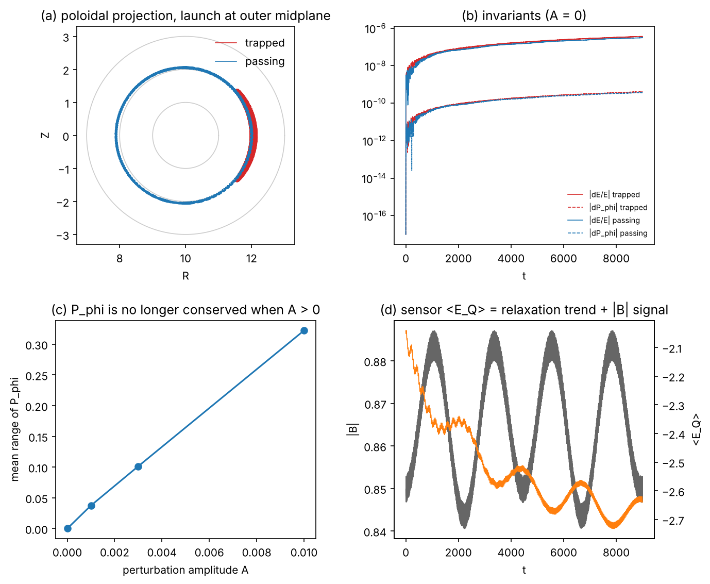
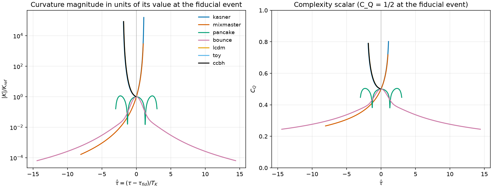
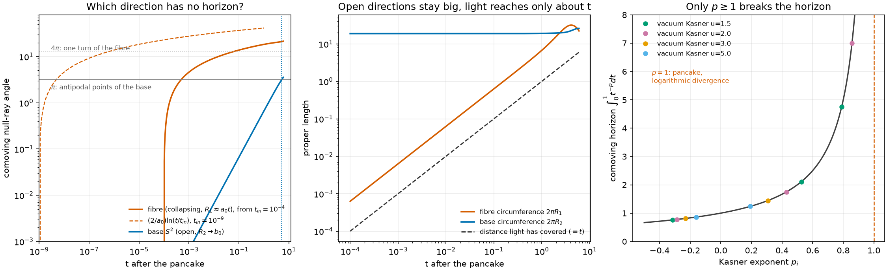
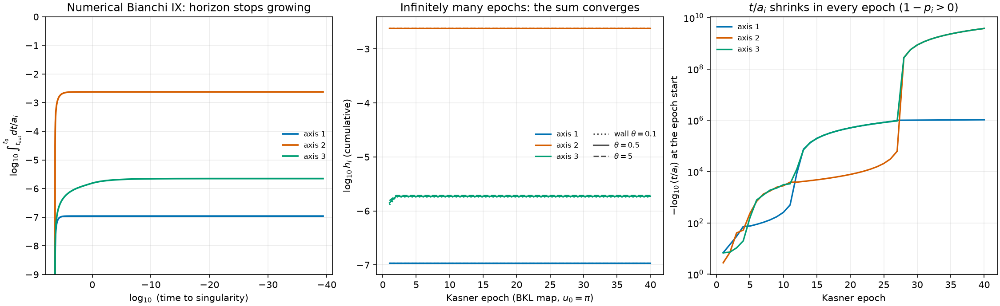
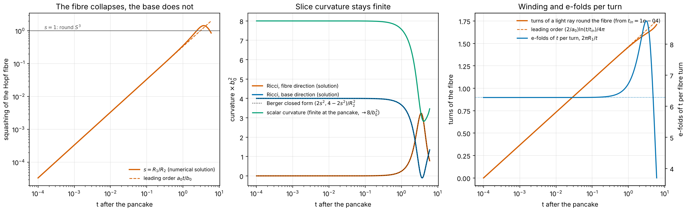

# Quantum Gravity Lab (QGL)


### 4.5 Tokamak mode (new)

`qgl_tokamak.py` is roadmap item 1: the test particle becomes a charged ion in an
axisymmetric tokamak field, and the JC sensor and a complexity profile are carried across.



*Physics (each point is tested in `tests/test_tokamak.py`).*  Large-aspect-ratio field
`B_phi = B0 R0/R` plus a poloidal field derived from a flux function
`psi = B0 rho^2 / (2 q0)`, so `div B = 0` exactly and `P_phi = m R v_phi + q psi` is an exact
invariant.  Full Lorentz-force orbits (units `B0 = 1`, `q/m = 1`).  For the unperturbed field:
energy is conserved to ~1e-6 (secular, integrator-limited) and `P_phi` to ~1e-9; the magnetic
moment only adiabatically.  Launched at the outer midplane, an ion is trapped when
`(v_par/v)^2 < 2 rho0/(R0 + rho0)`; orbits at 0.8x and 1.25x of that threshold behave
accordingly, passing ions advance poloidally at `v_par t / (2 pi q R0)` to within 15%, and a
deeply trapped ion's bounce period is within 20% of the small-epsilon formula (about 13% above
it in the test, as expected at `epsilon = 0.2`).

*Stylised (no claim of fusion relevance).*  The "complexity" profile
`C_T(rho) = 1/(1 + (rho/rho_t)^p)` has the same form as `C_Q(r)` and multiplies the amplitude of
an electrostatic wave `dphi = A C_T cos(m theta - n phi - w t)`.  With `A > 0`, `P_phi` is no
longer conserved and its spread grows with `A` (panel c); `confinement_scan` tabulates that and
the fraction of ions lost to the wall.  In the runs here no ion reached the wall within the
integration time, so the spread of `P_phi` is the usable measure, and no control claim is made.
The sensor's atomic frequency follows `|B|`, so its energy carries the bounce motion on top of its
own relaxation (panel d); that is by construction, not an independent measurement.

```bash
python qgl_tokamak.py             # short demonstration
python qgl_tokamak.py --figure    # regenerate figures/qgl_tokamak.png (about 45 s)
```

**Found while building this:** the core `JCQuantumEngine._apply_decays` damps populations but not
coherences, so the density matrix becomes non-positive (smallest eigenvalue about -0.012 after a
few time units) and `<sigma_z>` can fall below -1.  `qgl_jc_lindblad.LindbladJCEngine` replaces just
that step with the Kraus form of the same two decay channels; the tokamak sensor uses it.  The core
is unchanged, and `test_core_decay_breaks_positivity` documents the problem.  Swapping the engine
into the main pipeline would change its outputs slightly, so that is your call.

### 4.6 Anisotropic cosmology and EinsteinPy (new)

These modules are optional and need `pip install einsteinpy` for the symbolic and exact-GR parts.
The core (`unified_sandbox_core.py`) is not modified.

* **`qgl_einsteinpy.py`**: compares QGL's measured periapsis advance with the exact Schwarzschild value (elliptic-integral form) and with EinsteinPy's geodesics.
* **`qgl_kasner.py`**: Kasner exponents and the two vacuum conditions, symbolic Ricci / Riemann / Kretschmann via EinsteinPy, exact timelike geodesics, and `singularity_type(p)` (point / cigar / barrel / pancake).
  Vacuum Kasner is a cigar at the singularity unless it is flat, `(0, 0, 1)`.
* **`qgl_curvature.py`**: rewrites the complexity scalar and the sensor density proxy in terms of K. On Schwarzschild this reproduces the radius-based forms exactly; it also works where there is no radius (Kasner, Mixmaster).
* **`qgl_bkl.py`**: the Belinski–Khalatnikov–Lifshitz epoch map and a vacuum Bianchi IX (Mixmaster) integrator, with the sensor riding through the bounces on a comoving or a moving (geodesic) worldline.
  The coupling from curvature and speed to the sensor is a modelling choice, not derived physics.
* **`qgl_pancake.py`**: the non-singular pancake Big Bang of Dechant, Lasenby & Hobson (arXiv:0809.4335): a scalar field in a biaxial Bianchi IX universe where one scale factor goes through zero linearly while the curvature invariants stay finite.
  The field equations are re-derived and checked against the paper's equations; the sensor is driven by K(t) through the pancake.
  Also: the paper's own parameters (about 50 e-folds of scalar-driven inflation, R1/R2 -> 1), triaxial perturbations (the anisotropy freezes forward in time, but the curvature grows like delta^2/t^4 toward the pancake), and geodesics that wind logarithmically round the closed x-direction while spending almost no proper time at the crossing.
* **`qgl_tidal.py`**: tidal eigenvalues `a_i''/a_i` for comoving observers, and a complexity scalar driven by the tidal strength.
  Vacuum Kasner tides diverge like 1/t^2; at the pancake they stay finite.
* **`qgl_flrw.py`**: a flat-FLRW *toy* with a sigmoid-switched dark term, compared with LCDM, a Tsallis-horizon model and a Padé deceleration model, with a horizon-entropy second-law check (dS/dt >= 0 is q >= -1) and the sensor riding the expansion history.
  It is our own toy, inspired by the sigmoid-blend idea of the Fairfolio "LCDM+S" project, whose equations are unpublished; it does not reproduce that work and has not been fitted to data.
* **`qgl_ccbh.py`** (toy): black holes whose mass grows as `a^k` and are fed from the star formation history; `k = 3` gives a constant density (w = -1).
  Written from the stated physics, not from the DESI / Croker et al. equations, so it does not test those papers.
  In this bookkeeping `k = 3` needs a conversion efficiency of about 3.7 times all stellar mass formed to supply Omega_DE = 0.7.
* `qgl_flrw.py` also holds an exact **bounce** toy (dust with maximum density `rho_c`), a finite-curvature crossing for the sensor, in the spirit of the pancake; it is not Gaztañaga's mechanism.
* **`qgl_bkl_sweep.py`**: scans the Mixmaster starting parameter `u`; for each value it reports the Kasner exponents found against the Landau–Lifshitz map, the analytic epoch curvature `16u²(1+u)²/(1+u+u²)³ / t⁴`, the bounces, and the sensor's response to the first bounce.
  Large `u` is close to the flat `(0, 0, 1)` Kasner limit, so its bounces are late and gentle.
* **`qgl_compare.py`**: puts Kasner, Mixmaster, the pancake, the bounce, LCDM, the sigmoid toy and the coupled-black-hole toy on one footing.
  Each history is normalised to its own fiducial event (`K_hat = |K|/K_ref`, `tau_hat = (tau - tau_fid)/K_ref^(-1/4)`) and the same sensor is run with `K_ref = K_trans = 1`, so `C_Q = 1/2` at that event.
  Result: the singular histories drive `K_hat` up by orders of magnitude and the sensor with them; the pancake and the bounce stay finite and never do. LCDM, the sigmoid toy and the CCBH toy differ in `K_hat` by tens of percent, yet their `C_Q` histories agree to about 0.02, because `C_Q` depends only weakly on `K` (`K^(p/6)`). The sensor, as configured, cannot tell those three apart.
  The toys are our own and the footing is a convention, not a physical equivalence. Figure: `figures/qgl_compare.png`.
* **`qgl_horizon.py`**: tests the idea that the pancake's open directions break cosmological horizons. In our pancake model it is the *collapsing* direction (the closed fibre, `R_1 ~ a0 t`) whose horizon diverges, as `(2/a0) ln(t/t_in)`, so a light ray winds ever more times round a circle of vanishing circumference. The two open directions (`R_2 = R_3 -> b0`) keep an ordinary finite horizon of proper size ~ `t`; antipodal points of the base S^2 first meet at `t ~ pi b0/2` (about 5.1 for `b0 = 3`). For Kasner the comoving horizon is `t^(1-p)/(1-p)`, divergent only for `p >= 1`, which in vacuum is only `(1, 0, 0)`. **Mixmaster:** with the same criterion (`h_i = ∫ dt/a_i`, a proxy for Bianchi IX that I have not checked against real null geodesics) every axis has a *finite* horizon, the opposite of Misner's hope, because `t/a_i` shrinks like `t^(1-p_i)` in every epoch and `p_i < 1`; the numerical solution and a multi-precision sharp-wall BKL map (checked against it to a factor 2 in `h`) both saturate. Bounces briefly push `v_i` to about 1.1, which the map ignores. Misner's own argument was about the Hubble horizon of a momentarily static axis, and Chitre (1972) found circumnavigating light has vanishing measure (abstract only read). The fibre period `4 pi` is the standard-`S^3` value, checked in `tests/test_s3_identifications.py`; whether the paper's slices are `S^3` or the quotient `SO(3)` (period `2 pi`, which would double every winding count) is not checked.
* **Frame-dragging sign.** `unified_sandbox_core.py` previously applied the Lense–Thirring term as `z_hat x v`, opposite to the `a_LT = Omega (v x z_hat)` written above. It now follows the README, and `test_qgl_frame_dragging_has_the_exact_sign` (against exact Kerr geodesics, prograde spin reduces the periapsis advance) passes without `xfail`.

**Figures.**

Common footing for Kasner, Mixmaster, the pancake, the bounce, LCDM and the two toys (`python qgl_compare.py`, or `qgl_compare.plot_comparison`). Left: curvature in units of its value at the fiducial event. Right: the sensor's complexity scalar. LCDM, the sigmoid toy and the CCBH toy lie on top of each other.



Horizons at the pancake (`python qgl_horizon.py --figures`). Left: the collapsing fibre has a logarithmically divergent null-ray angle (dashed: the analytic law from `t_in = 1e-9`), the open base has a finite one that reaches `pi` only at `t ~ 5`. Middle: the fibre circle shrinks, the base stays large, light covers only about `t`. Right: the Kasner horizon integral diverges only at `p = 1`.



Horizons through the Mixmaster bounces (same command). Left: the numerical Bianchi IX horizon along each axis stops growing. Middle: the sharp-wall BKL map over 40 epochs, for three wall positions. Right: `-log10(t/a_i)` at each epoch start only grows, so `t/a_i` shrinks.



#### The pancake as a Hopf fibration (Berger sphere)

The slice of the biaxial pancake is `S^3` with the Hopf fibre scaled by `s = R_1/R_2`, a Berger sphere. Its Ricci curvatures are `(2 s^2, 4 - 2 s^2, 4 - 2 s^2)/R_2^2` and its scalar curvature is `(8 - 2 s^2)/R_2^2`, so as the fibre collapses (`s -> 0`) nothing diverges in the slice: the scalar curvature goes to `8/b0^2`. `qgl_hopf.py` follows this along the numerical solution rather than the leading order. For `a0 = 1, b0 = 3, f0 = 2, m = 0.5` the squashing follows `a0 t/b0` near the pancake, overshoots the round sphere (peak `s` about 1.44 near `t = 3.7`) and falls back, so the slice is not monotonically approaching a round `S^3`. A light ray winds `(2/a0) ln(t/t_in)/(4 pi)` times round the fibre, which is `1/(2 pi a0)` turns per e-fold of `t`; locally, one turn costs `2 pi R_1/t` e-folds, which tends to `2 pi a0`.



(`python qgl_hopf.py --figure`.) Left: `s(t)` against `a0 t/b0`. Middle: slice Ricci and scalar curvature from the solution against the Berger closed form, which agree to rounding, so this checks `qgl_bkl.ricci3` and the identification, not new physics. Right: turns of the fibre and e-folds per turn.

`tests/test_s3_identifications.py` checks the identifications this uses from the embedding `S^3 in C^2` (Euler-angle metric, `psi`-orbits are Hopf fibres, period `4 pi`, fibre length `2 pi R_1`, base radius `R_2/2`, Milnor's Ricci formula). The same formulas, written separately, are in the sister repository [HopfFibration](https://github.com/brentharts/HopfFibration) (`hopf_berger.py`, `hopf_pancake.py`); a scratch cross-check of that repository against this one (Berger Ricci and scalar, volume `2 pi^2 R_1 R_2 R_3`, fibre period, circumference, e-folds per turn) passed 18 of 18 comparisons. That cross-check is not in either repository's test suite.

Limits: the pancake solution here is leading order, not a solution of the field equations to all orders; the `S^3` versus `SO(3)` question above is open; and nothing here connects the pancake to Yang-Mills beyond the shared `S^3 = SU(2)`.

```bash
python qgl_kasner.py        # symbolic Kasner table
python qgl_bkl.py           # sensor through Mixmaster bounces
python qgl_bkl_sweep.py     # scan the starting u
python qgl_pancake.py       # pancake solution, curvature and sensor
python qgl_tidal.py         # tides: Kasner cigar vs pancake
python qgl_flrw.py          # toy FLRW vs LCDM / Tsallis / Pade
python qgl_ccbh.py          # coupled-black-hole conversion toy
python qgl_compare.py       # all scenarios on a common K(t) and sensor footing
python qgl_horizon.py       # particle horizons: Kasner, pancake, Mixmaster
python qgl_horizon.py --figures   # regenerate figures/qgl_horizon_*.png (about 10 s)
python qgl_hopf.py          # pancake as a Berger sphere: s(t), slice curvature, fibre winding
python qgl_hopf.py --figure # regenerate figures/qgl_hopf.png
pytest tests/ -q            # add --runslow for the slow EinsteinPy checks
```

## 5. Scientific status and roadmap

**What QGL *is***:

* A **computational lab** where:

  * GR-inspired corrections,
  * quantum sensors,
  * and information-theoretic diagnostics

  all act on the same orbit in a consistent codebase.

* A platform for experimenting with **geometry → quantum mapping**:
  how curvature and motion can be turned into tunable quantum parameters and observables.

**What QGL *is not***:

* A claim of a complete or correct quantum gravity theory.
* A production-grade astrodynamics package.

### Near-term directions

1. **Fusion-oriented extensions** (first step done: `qgl_tokamak.py`)

   * Replace Keplerian orbits with a simple tokamak-style geometry (closed magnetic field lines).
   * Interpret the “test particle” as a representative ion packet.
   * Use the JC sector as a stylized fusion sensor, and the complexity field as a proxy for local turbulence / instability.
   * Explore how modulation of geometric and complexity parameters might be used as a control-theoretic lever.

2. **Dark matter / protomatter sandbox**

   * Use `unified_darkmatter.py` to test alternative complexity / coupling rules and see how they modify effective mass distributions and orbital signatures.

3. **GPU and ensemble runs**

   * CPU ensembles of orbits now exist (`qgl_ensemble.py`).
   * Batch many orbits and JC sensors in parallel on GPU.
   * Turn QGL into a Monte-Carlo-style “quantum gravity lab” for exploring parameter spaces.

### References:
* Fang Fang (2017) "The Quasicrystalline Spin Network" https://www.youtube.com/watch?v=_g2JWp6F_xQ
* https://quantumgravityresearch.org/portfolio/a-deep-link-between-3d-and-8d/
* J.F. Sadoc a, R. Mosseri (1993) https://doi.org/10.1016/0022-3093(93)90351-W

* P.-P. Dechant, A. N. Lasenby, M. P. Hobson, *An anisotropic, non-singular early universe model leading to a realistic cosmology*, [arXiv:0809.4335](https://arxiv.org/html/0809.4335v2).
  A scalar field in a biaxial Bianchi IX geometry gives a “pancaking” Big Bang with finite curvature invariants.
  Also a compact statement of the point / pancake / cigar / barrel singularity types.

* S. Cotsakis, A. P. Yefremov, *100 years of mathematical cosmology: Models, theories, and problems*, [arXiv:2203.16443](https://arxiv.org/html/2203.16443v1).
  Survey covering the Kasner solution (Sec. 2.8), Bianchi models (Sec. 2.14) and BKL / Mixmaster (Secs. 3.4–3.5).

* S. Capozziello, R. D'Agostino, O. Luongo, *Thermodynamic parametrization of dark energy*, [arXiv:2202.03300](https://arxiv.org/pdf/2202.03300).
  Padé form of the dark-energy deceleration parameter; the second law on the apparent horizon requires q >= -1.

* N. Shahhoseini, M. Malekjani, A. Khodam-Mohammadi, *LCDM Model Against Gravity-Thermodynamics Conjecture: Observational Constraints After DESI 2024*, [arXiv:2501.03655](https://arxiv.org/html/2501.03655v1).
  Tsallis-entropy modified Friedmann equations, with beta = 1 recovering LCDM.

* DESI Collaboration (G. Tarlé, contact author), *Positive Neutrino Masses with DESI DR2 via Matter Conversion to Dark Energy*, [Phys. Rev. Lett. 135, 081003 (2025)](https://journals.aps.org/prl/abstract/10.1103/yb2k-kn7h).
  Tests matter conversion to dark energy through cosmologically coupled black holes tracking the star formation rate; the neutrino-mass result is model-dependent.

* K. S. Croker et al., *DESI Dark Energy Time Evolution is Recovered by Cosmologically Coupled Black Holes*, [arXiv:2405.12282](https://arxiv.org/abs/2405.12282).

* S. Ghodla, R. Easther, M. M. Briel, J. J. Eldridge, *Observational Implications of Cosmologically Coupled Black Holes*, [arXiv:2306.08199](https://arxiv.org/pdf/2306.08199v1).
  Mass growth `m = m_i (a/a_i)^k`; finds merger rates and SMBH spins in tension with observations for `k = 3`.

* E. Gaztañaga, *Cosmological bounce relics: Black holes, gravitational waves, and dark matter*, Phys. Rev. D 113 (2026), DOI 10.1103/pr4p-6m49 (known to me only through a [ScienceDaily summary](https://www.sciencedaily.com/releases/2026/08/260811011146.htm)).

* Einstein Toolkit, [`EinsteinInitialData/Exact` thorn guide](https://einsteintoolkit.org/thornguide/EinsteinInitialData/Exact/documentation.html).
  Library of exact spacetimes (Kasner variants, Schwarzschild and Kerr in several coordinates, and others) as 3+1 initial data; useful as an independent cross-check for the exact solutions used here.

---

## 6. License and contact

This project is released under **CC0 1.0 Universal** (public domain dedication).
You are free to copy, modify, and use it for any purpose, including commercial and research work.

Questions, ideas, or collaboration proposals:

**Jon Poplett**
Creator, Quantum Gravity Lab (QGL)

